<p align="center">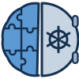</p>
<h1 align="center">NeuroRadVault</h1>
<p align="center"><b>One click away from downloading your desired neuroradiology dataset.</b></p>
<p align="center">
  <a href="../../actions/workflows/tests.yml"></a>
  <a href="../../actions/workflows/update-catalog.yml"></a>
  
  
  
</p>

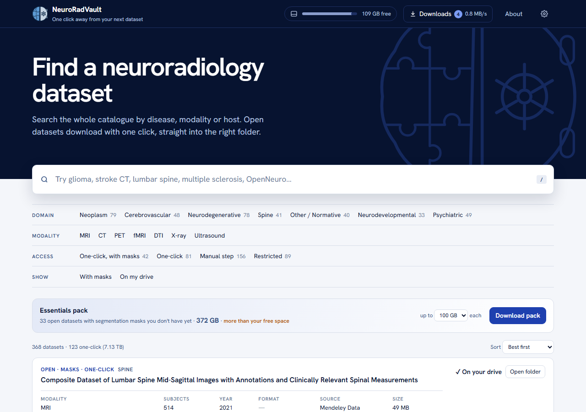

## What is it?

NeuroRadVault is a free app for finding and downloading public brain and spine imaging datasets. It lists
368 datasets (MRI, CT, PET, X-ray, ultrasound), tells you which ones are free to download, and downloads them
with one click into a tidy folder on your own drive.

- 🔎 **Find** a dataset by disease, imaging type or source in seconds.
- ⬇️ **Download** open datasets with one click. They land in the right folder automatically.
- 💾 **See your space**: how big each dataset is and how much room is left on your drive.
- 🔁 **Never start over**: if your internet drops or you close the app, downloads continue where they stopped.

Everything runs on your own computer. There's no account, no cloud and nothing to pay.

## Get started in 3 steps

1. **Install Python** (version 3.9 or newer) from [python.org/downloads](https://www.python.org/downloads/).
   On Windows, tick **"Add python.exe to PATH"** during setup.
2. **Download NeuroRadVault**: click the green **Code** button above, then **Download ZIP**, and unzip it anywhere.
   You can also [download the ZIP directly](../../archive/refs/heads/main.zip).
3. **Start it**:

   | Your computer | What to do |
   |---|---|
   | Windows | Double-click **`NeuroRadVault.bat`** |
   | Mac | Double-click **`NeuroRadVault.command`**. The first time, right-click it and choose *Open* instead. |
   | Linux | Run `./neuroradvault.sh` |

The app opens in your web browser. The first time, it asks where to keep your datasets; an external drive is
ideal. Pick one and click **Create my vault**. Next time it opens straight to your library.

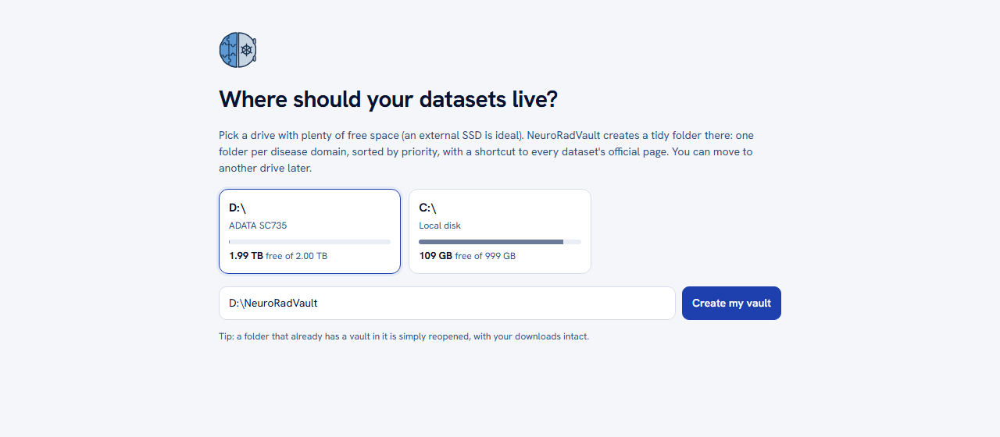

## How to use it

### 1. Find a dataset

Type in the search box, for example *glioma*, *stroke CT* or *lumbar spine*. Related words count too: *glioma*
also finds *glioblastoma* and *GBM*. Use the filters under the search box to narrow by disease area, imaging
type, or whether a dataset is free to download.

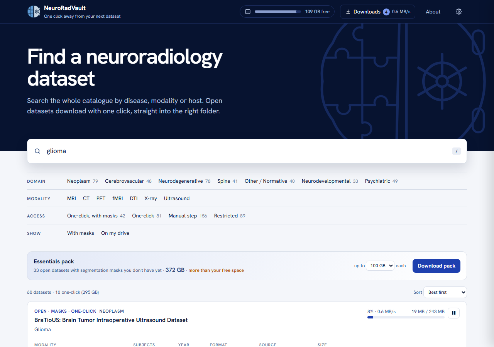

Each dataset shows a coloured label:

| Label | Meaning |
|---|---|
| **Open · masks · one-click** | Free, includes segmentation masks, downloads with one click |
| **Open · one-click** | Free, downloads with one click |
| **Manual step** | Free, but you need to register on the website first. The app gives you the link. |
| **Restricted** | You need to apply for access, for example ADNI or UK Biobank. The app gives you the link. |

### 2. Look at the details

Click a dataset's name to see everything about it: size, number of subjects, scanner, format, disease, and
the folder it will go into.

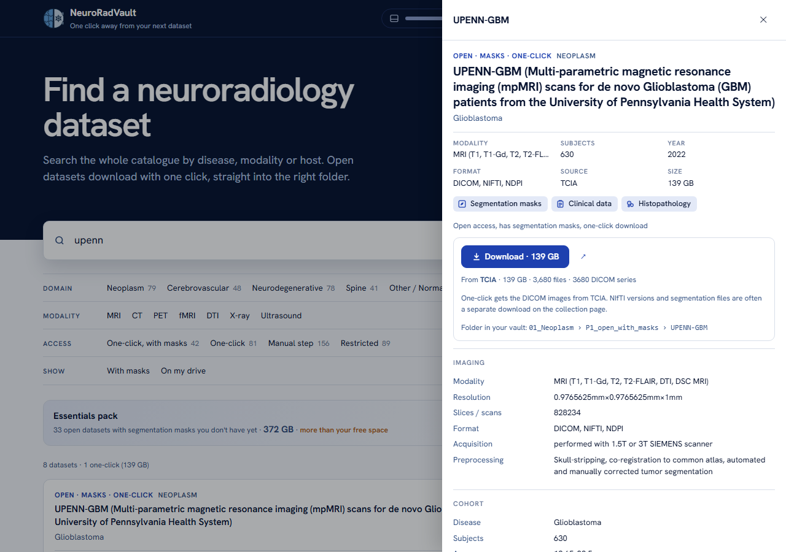

### 3. Download it

Click **Download**. That's it. The button turns into a progress bar. Click **Downloads** at the top to see
everything that's running.

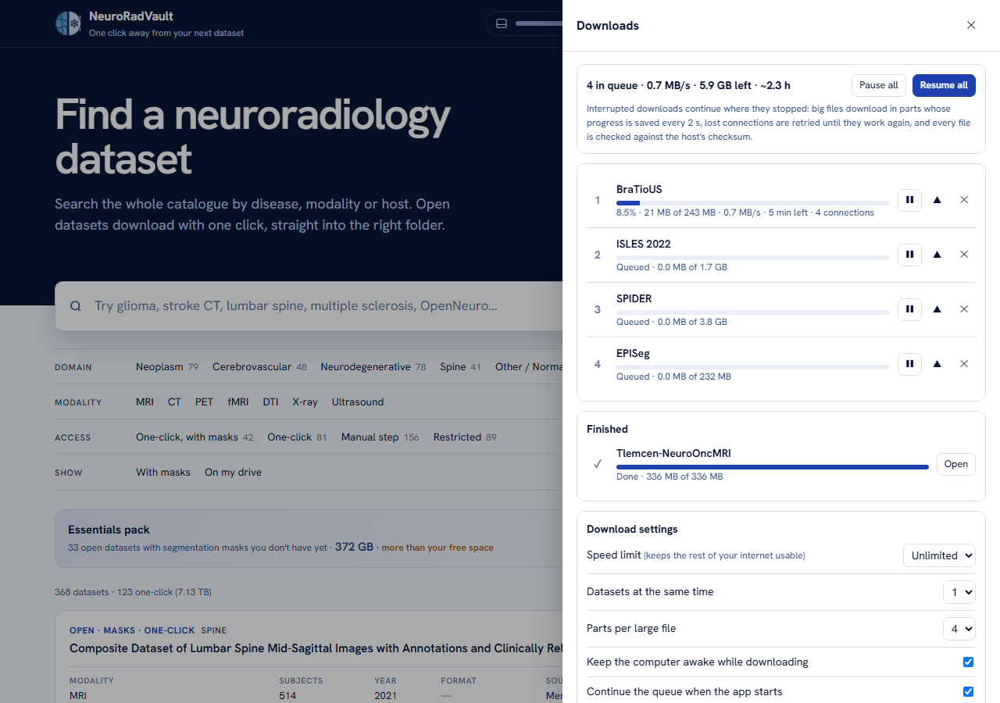

- **Pause** and **resume** any download, or everything at once.
- Change the order of the queue.
- Set a **speed limit** so the rest of your internet stays usable.
- Leave **Keep the computer awake** on for long downloads.

If your internet drops, the computer restarts or you close the window, the download continues from where it
stopped next time you open the app. Every file is checked against the original before it's marked done.

### 4. Keep an eye on space

Click the storage bar at the top to see your drive's space, how much your datasets use, and how much is still
to come. The app always keeps 20 GB free.

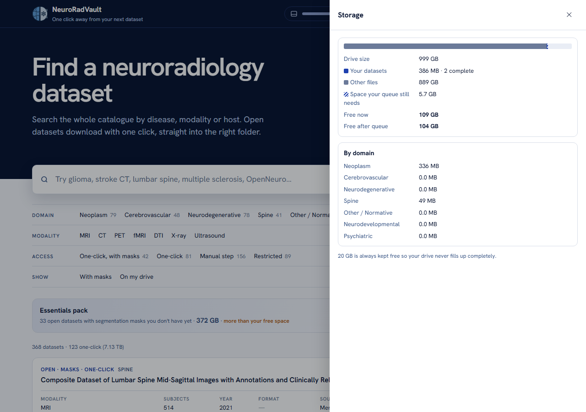

### 5. Make it yours

In **Settings** (the gear icon) you can untick the disease areas you don't need right now. They move to the
bottom of the list and their folders are marked `LATER`. You can also move your library to another drive.

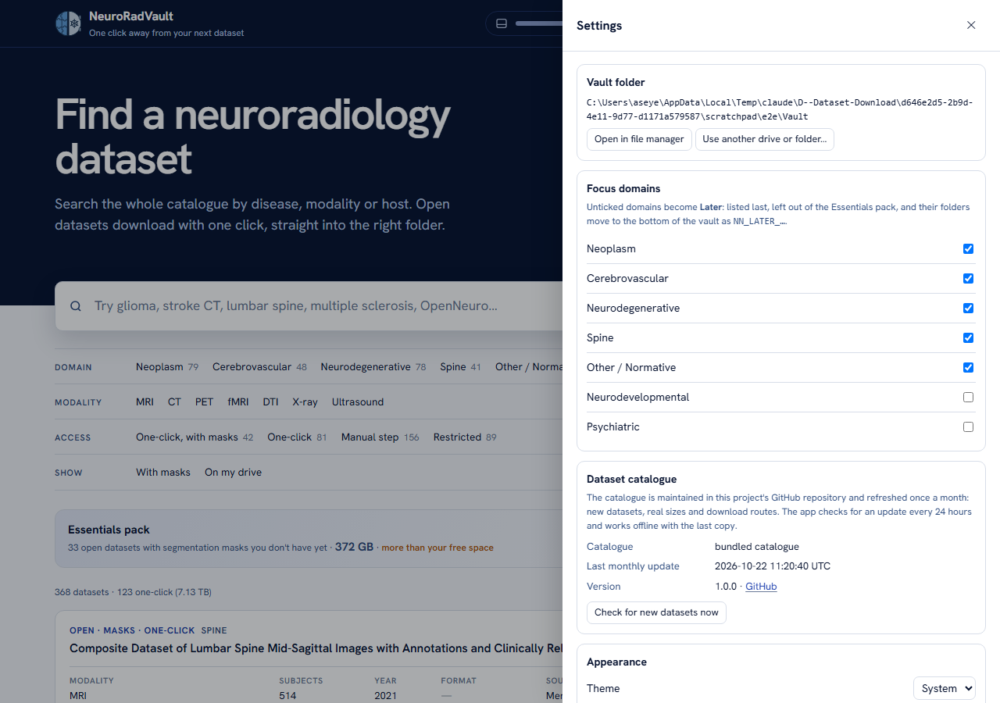

## Where your files go

```
NeuroRadVault/                      (the folder you picked)
├── 01_Neoplasm/
│   ├── P1_open_with_masks/          one-click downloads land here, one folder per dataset
│   ├── P2_open_no_masks/
│   ├── P3_manual_download/          shortcut to the website of each dataset that needs registration
│   └── P4_restricted_access/        shortcut to the access page of each restricted dataset
├── 02_Cerebrovascular/  …  07_Psychiatric/
├── Dataset_Index.csv                every dataset with its size, link and folder (opens in Excel)
└── .vault/                          the app's own notes (hidden; don't delete)
```

Every dataset, including the ones that need registration, has a shortcut to its official page in its folder.
You can plug the drive into another computer and open the same library there.

## Questions

**Is it really free?**
Yes. The app is free and open source. Each dataset keeps its own licence, and many ask you to cite them or use
them only for research. Check the dataset's official page (the ↗ button) before you use it.

**Why is my download slow?**
The app downloads several parts at once, but it can't go faster than your internet connection. Some sites also
limit speed per user. For big downloads (hundreds of GB), a wired or university connection helps a lot.

**Can it download the restricted datasets (ADNI, UK Biobank, …)?**
No. Those need an application to the data owner. The app shows you where to apply and creates a folder for
the data once you have it.

**How does the list of datasets stay up to date?**
On the 1st of every month, an automatic job on GitHub updates the list, re-checks every dataset's size and
download link, and publishes the result here. Your app picks up the update by itself within a day, and it works
offline with the last copy it has.

**What if I close the window during a download?**
Nothing is lost. Open the app again and the download continues.

## For developers

You only need Python. There's nothing else to install.

```bash
python -m vault                      # run the app (add --vault PATH, --port N, --no-browser)
python -m unittest discover -s tests # run the tests (no internet needed)
python -m vault.enrich               # rebuild the dataset list and sizes (what the monthly job runs)
```

| File | What it does |
|---|---|
| [`vault/web/index.html`](vault/web/index.html) | The whole user interface |
| [`vault/server.py`](vault/server.py) | Small local web server (only reachable from your own computer) |
| [`vault/downloader.py`](vault/downloader.py) | Download queue, resume, retries, checksums |
| [`vault/registry.py`](vault/registry.py) | Builds the dataset list |
| [`vault/hosts.py`](vault/hosts.py) | Talks to OpenNeuro, TCIA, Zenodo, Figshare, Mendeley Data, Hugging Face and OSF |
| [`data/`](data) | The dataset list and its monthly updates |

**Add a dataset:** add a row to [`data/registry/additions.csv`](data/registry/additions.csv) and open a pull
request. See [data/registry/README.md](data/registry/README.md). Ideas and bug reports are welcome in
[Issues](../../issues).

## About us

<table>
<tr>
<td align="center" valign="top" width="25%">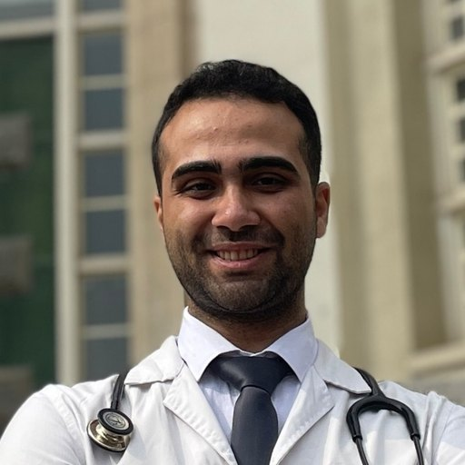<br><b>Amir Asef Agah</b><br><sub>MD · <a href="https://github.com/AmirAsefAgah">@AmirAsefAgah</a></sub><br><br><div align="left"><sub>Amir is a physician on the path to neurosurgery, driven by one question: how can imaging help surgeons make better decisions? As a Postdoctoral Research Fellow at ADIR, Tehran University of Medical Sciences, he works on MRI radiomics, cerebrovascular imaging, and automated segmentation. He also reviews for World Neurosurgery and JIIM.</sub></div><br><a href="https://www.linkedin.com/in/seyed-amir-asef-agah-552264180/"></a> <a href="https://github.com/AmirAsefAgah"></a> <a href="https://scholar.google.com/citations?user=Y0ZYG38AAAAJ&amp;hl=en"></a></td>
<td align="center" valign="top" width="25%"><br><b>Mostafa Neshat</b><br><sub>MD · <a href="https://github.com/mostafansh">@mostafansh</a></sub><br><br><div align="left"><sub>Mostafa sees a brain scan as both a patient’s story and data waiting to be understood. A physician at ADIR, he turns clinical neuroimaging into data AI models can learn from, and in 2025 he began an MSc in computer science. He’s on his way to radiology, hoping to make it more computational and quantitative.</sub></div><br><a href="https://www.linkedin.com/in/mostafansh/"></a> <a href="https://github.com/mostafansh"></a> <a href="https://scholar.google.com/citations?hl=en&amp;user=xIceI6AAAAAJ"></a></td>
<td align="center" valign="top" width="25%">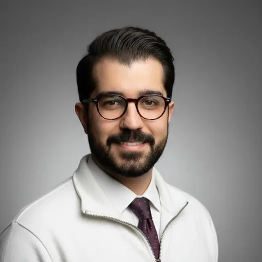<br><b>Ahmadreza Sohrabi</b><br><sub>MD · <a href="https://github.com/ar1so">@ar1so</a></sub><br><br><div align="left"><sub>Ahmadreza discovered in medical school how much technology could change healthcare, and he has been building that change ever since. He’s Tech Lead at PetMagix and an AI Research Fellow at ADIR, developing deep learning for medical imaging. He also contributes to open-source medical AI and mentors young developer-researchers, guided by a belief in thoughtful, ethical AI.</sub></div><br><a href="https://www.linkedin.com/in/arsohrabi/"></a> <a href="https://github.com/ar1so"></a> <a href="https://scholar.google.com/citations?user=fLVfLUQAAAAJ&amp;hl=en"></a></td>
<td align="center" valign="top" width="25%">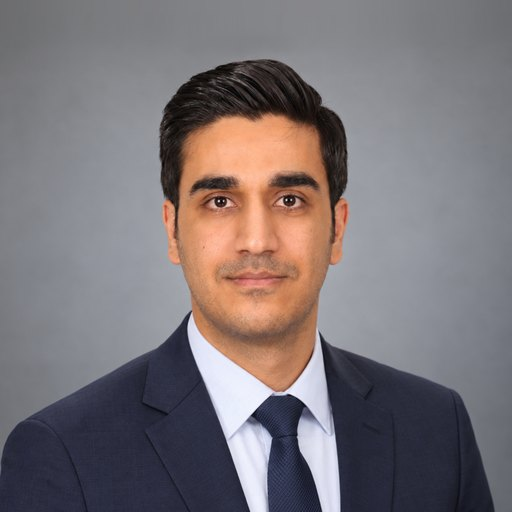<br><b>Moein Ghasemi</b><br><sub>MD, PhD · <a href="https://github.com/MoeinGhasemii">@MoeinGhasemii</a></sub><br><br><div align="left"><sub>Moein is a physician and researcher at Tehran University of Medical Sciences, curious about what AI can make possible in medicine. He’s drawn to medical imaging and autonomous surgery. As one of the platform’s developers, he loves turning complex ideas into tools people can use. He hopes to become a surgeon bringing AI into the operating room and beyond.</sub></div><br><a href="https://www.linkedin.com/in/moein-ghasemi-a708a9127/"></a> <a href="https://github.com/MoeinGhasemii"></a> <a href="https://scholar.google.com/citations?hl=en&amp;user=MLjOPz4AAAAJ"></a></td>
</tr>
</table>

## Licence

The code is MIT licensed (see [LICENSE](LICENSE)). Each dataset has its own licence; please respect it and
cite the dataset's authors. Notes on the dataset list are in [data/registry/README.md](data/registry/README.md).

---

<p align="center"><sub>Inspired by <a href="https://github.com/NeuroAIHub-Registry/NeuroAIHub">NeuroAIHub</a>.</sub></p>
